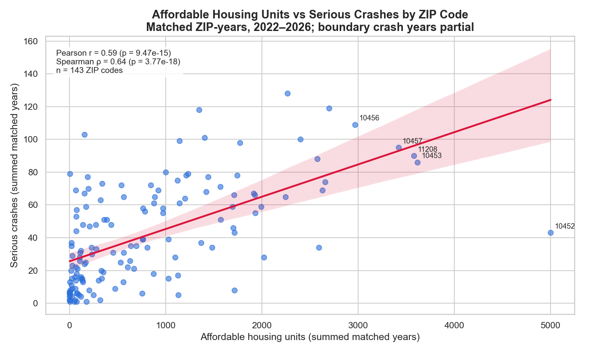
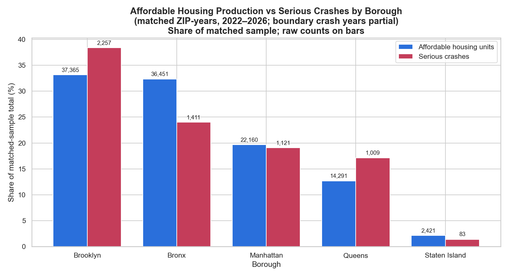

# nyc-housing-transportation-analysis

## Project Description

This project studies the relationship between affordable housing growth and road safety in New York City.

## Person 1 – Housing Data

### Responsibilities
- Loaded and explored the Affordable Housing Production by Building dataset.
- Performed Exploratory Data Analysis (EDA).
- Checked missing values, duplicate records, and potential outliers.
- Cleaned and standardized the housing data.
- Standardized ZIP codes and borough names.
- Extracted the year from the project start date.
- Created the cleaned dataset: `df_housing_clean`.

### Dataset Information
- Dataset: Affordable Housing Production by Building
- Dataset ID: `hg8x-zxpr`
- Original size: 9,551 rows and 41 columns.
- Cleaned size: 9,551 rows and 42 columns.

### Important Cleaning Decisions
- Missing ZIP codes were retained because their correct values were unknown.
- Missing affordable housing unit values were not replaced with zero.
- Potential outliers were retained because they may represent valid large buildings.
- No exact duplicate rows were found.

### Research Questions & Findings

**RQ1 — Do ZIP codes with more affordable housing units also have more serious crashes?**

Across 143 ZIP codes (2022–2026) there is a moderate, positive and statistically significant relationship (Spearman ρ = 0.64, Pearson r = 0.59, p < 0.001). Bronx ZIPs 10456, 10457, 10453 and Brooklyn 11208 are high on both. Exceptions: 10452 has the most affordable units (5,001) but only 43 serious crashes, while 11234 has 157 units but 103 crashes. Correlation is not causation — density and traffic volume likely drive both.

**RQ2 — Which boroughs have the highest affordable housing production and serious crash counts?**

Brooklyn leads both: 37,365 affordable units (33.2% of NYC) and 2,257 serious crashes (38.4%). The Bronx builds almost as much housing (36,451, 32.3%) but has a much smaller crash share (24.0%). Brooklyn and Queens have a higher share of crashes than of housing, Manhattan is balanced, and Staten Island is low on both. Raw totals favour larger boroughs; per-capita figures would be a fairer comparison.
