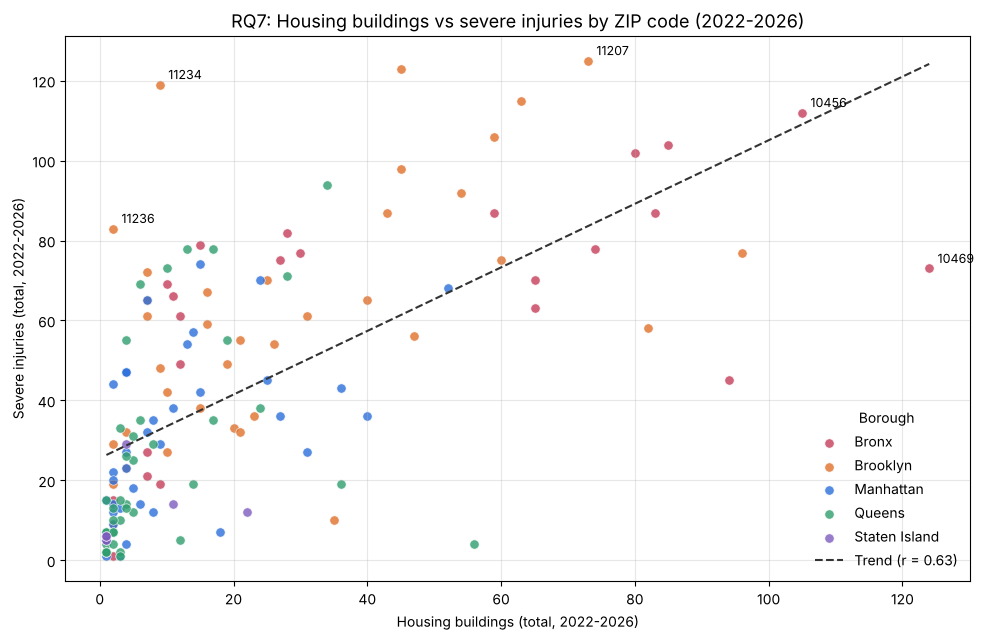
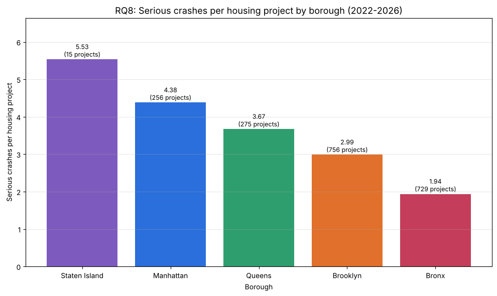

# nyc-housing-transportation-analysis

## Project Description

This project studies the relationship between affordable housing growth and road safety in New York City.

## Person 1 – Housing Data

### Responsibilities
- Loaded and explored the Affordable Housing Production by Building dataset.
- Performed Exploratory Data Analysis (EDA).
- Checked missing values, duplicate records, and potential outliers.
- Cleaned and standardized the housing data.
- Standardized ZIP codes and borough names.
- Extracted the year from the project start date.
- Created the cleaned dataset: `df_housing_clean`.

### Dataset Information
- Dataset: Affordable Housing Production by Building
- Dataset ID: `hg8x-zxpr`
- Original size: 9,551 rows and 41 columns.
- Cleaned size: 9,551 rows and 42 columns.

### Important Cleaning Decisions
- Missing ZIP codes were retained because their correct values were unknown.
- Missing affordable housing unit values were not replaced with zero.
- Potential outliers were retained because they may represent valid large buildings.
- No exact duplicate rows were found.

### Research Questions & Findings

**RQ1 — Do ZIP codes with more affordable housing units also have more serious crashes?**


Across 143 ZIP codes (2022–2026) there is a moderate, positive and statistically significant relationship (Spearman ρ = 0.64, Pearson r = 0.59, p < 0.001). Bronx ZIPs 10456, 10457, 10453 and Brooklyn 11208 are high on both. Exceptions: 10452 has the most affordable units (5,001) but only 43 serious crashes, while 11234 has 157 units but 103 crashes. Correlation is not causation — density and traffic volume likely drive both.

**RQ2 — Which boroughs have the highest affordable housing production and serious crash counts?**


Brooklyn leads both: 37,365 affordable units (33.2% of NYC) and 2,257 serious crashes (38.4%). The Bronx builds almost as much housing (36,451, 32.3%) but has a much smaller crash share (24.0%). Brooklyn and Queens have a higher share of crashes than of housing, Manhattan is balanced, and Staten Island is low on both. Raw totals favour larger boroughs; per-capita figures would be a fairer comparison.

**Data notes:** `df_integrated` has no missing values, so nothing was filled with 0. Totals cover 2022–2026, where 2026 is a partial year and 2022 also appears partial (339 serious crashes vs ~1,550–1,850 in each full year), so totals should not be read as five full years.

## Person 4: Ahmed – Website

### Responsibilities
- Built the interactive website with Dash (Python/Plotly), in the `app/` folder.
- Added dropdown filters for borough, ZIP code, housing measure and transportation measure, plus a year range slider.
- Added a search mode that turns typed text (e.g. "Brooklyn 2022 new buildings") into filter values.
- Added the "Generate Report" button, which updates all visualizations and summary figures from the selected filters.
- Connected the website to `df_integrated` (one row per ZIP code and year).
- Added a "No data matches" message for filter combinations that return no rows.
- Created the RQ7 and RQ8 visualizations and their analysis in `RQ7_RQ8_Research_Questions.ipynb`.

### Run the Website Locally
```bash
python3 -m venv venv
source venv/bin/activate        # Windows: venv\Scripts\activate
pip install -r requirements.txt
python3 app/app.py
```
Then open http://127.0.0.1:8050. The website reads `df_integrated.csv` from the repository root (or from `data/`).

### Website Structure
- `app/app.py` – page layout, filters, search mode and the Generate Report callback.
- `app/data_loader.py` – loads `df_integrated` and defines the housing and transportation dropdown options.
- `app/charts/` – one file per pair of research questions (`rq1_rq2.py` … `rq11_rq12.py`), listed in `app/charts/__init__.py`. `style.py` gives every chart the same look.
- `app/assets/style.css` – page styling.

### Research Questions & Findings

**RQ7 — Is a higher number of housing buildings associated with more severe injuries?**



Across 143 ZIP codes (2022–2026) there is a moderate-to-strong positive association between housing buildings and severe injuries (Pearson r = 0.63, Spearman ρ = 0.73, p < 0.001). The result holds on the full years 2023–2025 (r = 0.57, ρ = 0.70). Bronx ZIPs 10469 and 10456 lead in housing buildings and are also among the highest for injuries. Exceptions: Brooklyn 11234 has only 9 buildings but 119 severe injuries, and 11236 has 2 buildings but 83. This is an association, not causation — larger, denser or busier ZIP codes can have more of both.

**RQ8 — Which boroughs have the highest number of serious crashes per housing project?**



Staten Island has the most serious crashes per housing project (5.53), followed by Manhattan (4.38), Queens (3.67) and Brooklyn (2.99); the Bronx has the fewest (1.94). The ranking is the same for 2023–2025. The Bronx and Brooklyn build a similar number of projects (729 and 756), but the Bronx has far fewer crashes per project. Staten Island's ratio rests on only 15 projects, so it is the least reliable. The ratio does not account for population, road length or traffic volume.
